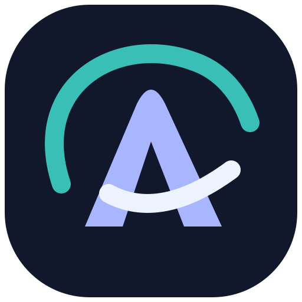

# Aura 2 — браузер для Linux и Windows



[English](README.md) | **Русский**

Aura разрабатывается с существенной помощью ИИ — **OpenAI Codex**: при проектировании,
написании кода, документации и автоматических проверок. Автор проекта задаёт направление
и принимает продуктовые решения. Использование ИИ не означает отсутствия ошибок; это preview-версия.

Рабочая браузерная оболочка на **C++20 + CEF OSR + Skia**. Обычный запуск открывает браузер:
вкладки, адресную строку, навигацию и собственную новую вкладку. Весь интерфейс нарисован Skia;
HTML используется только для посещаемых страниц.

Windows-порт использует то же приложение и интерфейс, что и Linux: **Win32 + Skia raster + CEF OSR**.
Статус его сборки и проверок виден в [GitHub Actions](https://github.com/Sttanors/aura-browser/actions).
Готовые portable-сборки Windows и Linux доступны в [GitHub Releases](https://github.com/Sttanors/aura-browser/releases/tag/v0.2.0-preview.3.1).
Для Windows скачайте `aura2-windows64.zip`, для Linux — `aura2-linux64.zip`.
Распакуйте архив целиком и запустите **Aura2/aura_browser.exe**. Windows 10/11 x64.
Сборка пока не подписана; автоматического обновления нет.

Windows x64 проверена в CI: сборка, 38 тестов CTest (один тест с внешним CRX пропущен),
запуск настоящей страницы, ввод `Windows Привет`, переходы и JavaScript-диалог,
переключение языка и сохранение масштаба интерфейса 125% после перезапуска.
[Проверенный запуск](https://github.com/Sttanors/aura-browser/actions/runs/39395547988).

## Установка в систему

Все варианты доступны в [релизе](https://github.com/Sttanors/aura-browser/releases/tag/v0.2.0-preview.3.1).
Установщики содержат браузер. Пакетный менеджер Linux может скачать системные зависимости.

| Платформа | Файл | Запуск |
|---|---|---|
| Windows 10/11 x64 | `aura2-windows64-setup.exe` | Откройте файл и следуйте мастеру на русском или английском |
| Linux x86_64 | `aura2-linux64.run` | `bash ~/Загрузки/aura2-linux64.run` (укажите свой путь) |

### Пакеты для дистрибутивов Linux

Эти пакеты устанавливают Aura для всей системы в `/opt/aura-browser`, добавляют команду
`/usr/bin/aura-browser` и ярлык в меню приложений. Профиль каждого пользователя остаётся
в `${XDG_DATA_HOME:-~/.local/share}/aura-browser-profile`, как у `.run`-версии.
Удаление пакета сохраняет профиль. Перед обновлением закройте браузер.

| Дистрибутив (x86_64) | Установка скачанного пакета | Удаление |
|---|---|---|
| Arch Linux / CachyOS (актуальный rolling) | `sudo pacman -U ./aura-browser-0.2.0rc3-1-x86_64.pkg.tar.gz` | `sudo pacman -R aura-browser` |
| Debian 13+ | `sudo apt install './aura-browser_0.2.0-preview.3-1_amd64.deb'` | `sudo apt remove aura-browser` |
| Fedora 44 | `sudo dnf install './aura-browser-0.2.0-preview.3-1.x86_64.rpm'` | `sudo dnf remove aura-browser` |

Пакетный менеджер установит необходимые системные библиотеки. Сборка использует ABI Debian 13,
а не более новые библиотеки компьютера разработчика. Debian 12 не поддерживается.
Если раньше ставили `.run`, сначала закройте Aura и выполните `~/.local/bin/aura-browser-uninstall`.
Профиль сохранится, а прежний пользовательский ярлык не будет перекрывать системный пакет.
Затем установите пакет своего дистрибутива. Выберите один способ установки для пользователя.

Windows: Aura устанавливается в `%LOCALAPPDATA%\Programs\Aura Browser`, появляется в меню «Пуск».
Мастер предлагает дополнительный ярлык на рабочем столе. Удаление — через «Установленные приложения».
Профиль ярлыков хранится в `%LOCALAPPDATA%\Aura Browser\profile`.

Linux **`.run`**: запускайте установщик от обычного пользователя **без sudo**. Приложение устанавливается в
`${XDG_DATA_HOME:-~/.local/share}/aura-browser`, ярлык — в меню приложений, команда запуска —
`~/.local/bin/aura-browser`. После установки достаточно найти **Aura Browser** в меню.
Удаление: `~/.local/bin/aura-browser-uninstall`. Профиль хранится отдельно в
`${XDG_DATA_HOME:-~/.local/share}/aura-browser-profile`. Для установки нужны Bash, tar, gzip и sha256sum;
системные библиотеки CEF/X11 должны быть установлены в дистрибутиве.

Установщики Windows и `.run` работают для текущего пользователя и сохраняют профиль при переустановке и удалении.
Данные portable-версии автоматически не переносятся. Перед установкой поверх прежней закройте Aura.
Браузер по умолчанию не меняется. Подписи и автоматического обновления пока нет.

## Сборка Windows

Нужны Visual Studio 2022 C++ / Windows SDK, LLVM clang-cl, CMake 3.31+, Python 3.12+,
Git и Rust 1.90+. В **x64 Native Tools Command Prompt**:

```bat
git clone https://github.com/Sttanors/aura-browser.git
cd aura-browser
git clone https://github.com/microsoft/vcpkg.git third_party/vcpkg
git -C third_party/vcpkg checkout 469a0504e4a6ebf6173d1c0f51a7fa34c382fd43
call third_party\vcpkg\bootstrap-vcpkg.bat -disableMetrics
python scripts/bootstrap.py --jobs 4
cmake --preset windows-x64-release
cmake --build --preset windows-x64-release --parallel 4
ctest --preset windows-x64-release
python scripts/package.py
```

Зависимости OpenSSL/libarchive собираются vcpkg со статическим CRT; CEF sandbox включён.
`aura_browser.exe` — sandbox bootstrap CEF, загружающий `aura_browser.dll`. Оба файла обязательны.
Windows-сборка по умолчанию включает полноценный браузер с программным выводом.
Для старого диагностического GPU-стенда отдельно запустите bootstrap с `--diagnostic-angle`
и CMake с `-DAURA_BUILD_COMPATIBILITY_HARNESS=ON`. Он не требуется для обычного браузера.
Из PowerShell запуск исходной сборки: `./run.ps1`. Профиль в `.aura-profile`.
В portable ZIP профиль создаётся в папке `profile` рядом с приложением.

## Запуск Linux

```bash
./run.sh
./run.sh --url=https://example.com/
./run.sh --theme=ember-light
```

Linux — основная рабочая платформа. В Wayland-сессии окно использует **XWayland**.
После сообщения о полном зависании ПК аппаратный путь отключён **по умолчанию**:
оболочка использует **Skia raster / X11**, CEF запускается без аппаратного GPU/video acceleration.
Обычный запуск не создаёт EGL context Aura. Sandbox Chromium остаётся включённым.
Экспериментальный EGL/GLES путь сохранён в коде, но не считается стабильным на текущей системе.
Нативный Wayland и Vulkan ещё не реализованы.

## Возможности

- Независимые CEF-вкладки: создание, переключение, закрытие, восстановление закрытой вкладки,
  перетаскивание порядка в sidebar, закрепление, дублирование и выключение звука через меню вкладки.
- Адресная строка с выделением, Unicode-редактированием, clipboard и подсказками из истории/закладок.
  Адреса открываются напрямую; для поиска можно выбрать DuckDuckGo, Google, Bing или Yandex.
- Назад/вперёд, reload/stop, zoom, favicon, title, индикатор загрузки, обработка ошибки страницы.
- Новая вкладка на Skia с собственным поиском и работающими быстрыми ссылками.
- Постоянный профиль: cookies/cache CEF, история Aura, закладки, тема и восстановление URL вкладок.
- Приватные вкладки с отдельным CEF request context в памяти; они не попадают в историю Aura и сохранённую сессию.
- Панель загрузок: прогресс, пауза/возобновление, отмена и открытие папки.
- Поиск по странице, собственное контекстное меню, JavaScript alert/confirm/prompt и before-unload dialog.
- Отдельное окно Chromium DevTools и вызов CEF печати.
- Aurora, Ember и Monolith, каждая в светлом и тёмном варианте; переключение без перезапуска.
- Русский и English для собственного интерфейса Aura: панели, новая вкладка, меню и уведомления.
- Настройки поисковика, масштаба, истории, подсказок, восстановления вкладок и оформления.

Приватный режим сейчас открывает **вкладку в текущем окне**. Это ещё не отдельное приватное окно.
Восстанавливаются URL и порядок обычных вкладок; back/forward stack между запусками не сохраняется.
Менеджера паролей, автоматического обновления браузера и синхронизации пока нет.
Полный CJK IME, DRM/кодеки, печать и разные оконные менеджеры требуют отдельных проверок.

Прокрутка страниц использует анимацию Chromium. Частота CEF автоматически подстраивается
под монитор, включая 120/144/165 Гц. В Wayland-сессии частота читается из wl_output,
в X11 — из RandR; при изменении режима открытые вкладки обновляются автоматически.
Программный вывод использует MIT-SHM и синхронизированную очередь XPresent из двух буферов.
Если расширения недоступны, готовое изображение копируется из offscreen pixmap.
Буфер окна сохраняется между кадрами, при прокрутке обновляется область сайта.
Фактическая частота кадров зависит от страницы, размера окна и производительности CPU.
Для сборки нужны headers wayland-client, X11/Xext, Xpresent и Xrandr;
для запуска — libwayland-client.so.0 и прежние зависимости X11/CEF.

## Настройки и язык

Откройте **Settings / Настройки** внизу боковой панели или шестерёнку в тулбаре.
Каталог содержит **85 настроек** в десяти разделах и поиск по английским / русским названиям
и описаниям. **Ctrl F** внутри настроек фокусирует поиск. Выбор **Основные → Язык интерфейса**
сразу переключает панели, новую вкладку, меню и уведомления между Русским и English.

| Раздел | Возможности |
|---|---|
| Основные | Язык, поисковик, восстановление сессии, домашняя страница, запуск и новая вкладка, язык сайтов |
| Вкладки | Открытие рядом / в конце, фоновые ссылки, выбор после закрытия, подтверждение выхода, средняя кнопка, колесо, звук |
| Внешний вид | Масштаб интерфейса 75–200%, шесть тем, акцентный цвет, значки и адреса сайтов, предпросмотр ссылок, анимация |
| Веб-страницы | Масштаб, размер / семейство / минимум шрифта, JavaScript, картинки, шрифты сайтов, Local Storage, поля и Tab-навигация |
| Приватность | Лимит / срок истории, источники / число подсказок, очистка при выходе, DNT и Referer |
| Разрешения | Нежелательные окна, JS-диалоги, уведомления, местоположение, камера, микрофон, clipboard, MIDI, датчики |
| Загрузки | Собственная папка, запрос имени, дата в имени, показ / закрытие панели, уведомления |
| Защита | Реклама / трекеры, косметические фильтры, Dark Reader, яркость / контраст / сепия, исключения сайтов и расширения |
| Данные | Очистка истории, cookie, сетевого кэша и сброс настроек |
| Начальная страница | Масштаб 50–200%, ширина и фон, свой заголовок и подпись, логотип, часы, фоновое изображение и автопалитра, колонки / вид быстрых ссылок |

**Внешний вид → Масштаб интерфейса** меняет вкладки, панели, кнопки, надписи и окна расширений
сразу, без перезапуска. Выбор сохраняется. В маленьком окне масштаб автоматически ограничивается,
чтобы элементы оставались доступны; рядом показан фактически применённый процент. При увеличении
окна выбранный масштаб восстанавливается. **Ctrl Shift 0** сбрасывает интерфейс до 100%.
Масштаб сайтов и отдельная настройка начальной страницы сохраняют свои значения.

Настройки сохраняются автоматически. Масштаб сразу меняет открытые страницы; **Ctrl 0** возвращает
выбранное значение. Параметры содержимого с пометкой **«Для новых вкладок»** применяются при создании
новой CEF-вкладки. Изменение предпочтительного языка сайтов требует перезапуска Aura.
**Alt Home** открывает домашнюю страницу. Язык интерфейса не переводит тексты сайтов.

История может хранить 100–10 000 записей; срок — до очистки, 7 / 30 / 90 дней или год.
Отключение записи не удаляет прежнюю историю. Очистка cookie завершает сессии на сайтах;
сброс настроек сохраняет историю, закладки и скачанные файлы. Для очистки данных есть подтверждение.
Очистка при выходе выполняется при обычном завершении, а не при аварийной остановке процесса.
DNT отправляет запрос сайтам, а не блокирует отслеживание.

В небольшом окне содержимое прокручивается колесом, Page Up / Page Down / Home / End или нажатием
на полосу прокрутки. Заголовок, поиск и категории остаются на месте. Профили прежних версий
читаются с сохранением истории, закладок и вкладок; новые параметры получают значения по умолчанию.

## Кастомизация начальной страницы

Кнопка **Настроить страницу** внизу новой вкладки открывает отдельный раздел настроек.
Слева находятся **− / 100% / +**: процент возвращает 100%. Также работают Ctrl +/−,
Ctrl+колесо и Ctrl+0. Масштаб начальной страницы хранится отдельно от масштаба сайтов.
Если при крупном масштабе содержимое не помещается, используйте колесо или Page Up / Page Down,
Home / End. Кнопки настройки и масштаба остаются видимыми.

Можно изменить ширину, убрать свечение, логотип или подпись, задать собственное приветствие,
выбрать карточки / строки и число колонок ссылок (до шести).
Кнопка **Быстрые ссылки** открывает список с добавлением, изменением названия / адреса,
удалением, отменой удаления и стрелками изменения порядка. Три прежних адреса автоматически
переносятся в этот список. Поддерживаются http:// и https://; список рассчитан на сотни ссылок
(защитный предел — 1000). Правый клик по карточке также открывает управление ссылкой. Приватные вкладки сохраняют
собственное пояснение о приватности. Акцентный цвет всей оболочки меняется в **Внешний вид**.

**Настройки → Начальная страница → Фоновое изображение → Обзор…** — выбор PNG / JPEG
с компьютера. Можно также вставить абсолютный путь и нажать «Сохранить» или Enter.
Изображение копируется в профиль: перемещение исходного файла не убирает фон.
«Заполнить» обрезает края, «Вписать» показывает изображение целиком. Есть затемнение 0–80%.
**Подобрать тему по изображению** автоматически меняет цвета всей оболочки, сохраняя
выбранный светлый / тёмный режим. Выключите эту настройку для собственной темы и акцента.
Для читаемости на изображении используется общая подложка под содержимым.

Поддерживаются PNG / JPEG до 20 МБ, до 8192 пикселей по стороне. Ограничения в 16 мегапикселей больше нет. Размеры проверяются до декодирования;
изображение уменьшается для хранения в оперативной памяти. Оригинал не изменяется.
На Windows выбор файла использует системный диалог. На Linux — установленный `zenity` с программной отрисовкой; при его отсутствии
можно ввести путь вручную. Команда «Убрать фоновое изображение» удаляет только копию в профиле.


## Клавиатура

| Комбинация | Действие |
|---|---|
| Ctrl L | Адресная строка |
| Alt Home | Домашняя страница |
| Ctrl T / Ctrl W | Новая / закрыть вкладку |
| Ctrl Shift T | Восстановить закрытую вкладку |
| Ctrl Tab / Ctrl Shift Tab | Следующая / предыдущая вкладка |
| Ctrl 1…8 / Ctrl 9 | Выбрать вкладку / последнюю |
| Ctrl Shift N | Новая приватная вкладка |
| Alt ← / Alt → | Назад / вперёд |
| Ctrl R / F5 | Обновить или остановить загрузку |
| Ctrl Shift R | Reload без cache |
| Ctrl + / Ctrl − / Ctrl 0 | Масштаб сайта; на начальной странице — её отдельный масштаб |
| Ctrl D / Ctrl B | Закладка / панель закладок |
| Ctrl H / Ctrl J | История / загрузки |
| Ctrl F / F3 / Shift F3 | Поиск / следующее / предыдущее совпадение |
| Ctrl P / F12 | Печать / DevTools |
| F6 / F7 | Сменить ауру / светлую-тёмную тему |
| F10 | Перенести фокус со страницы в интерфейс браузера |
| Tab / Shift Tab | Следующий / предыдущий элемент открытой панели |
| Enter / Space | Активировать выделенный нативный элемент |
| Page Up / Page Down / Home / End | Прокрутка открытой панели |
| Ctrl Q / Ctrl Shift W | Закрыть браузер |

Правый клик по вкладке открывает меню pin/mute/duplicate/close. Средний клик закрывает вкладку.
Заголовок и края окна позволяют перемещать и менять размер окна; справа — minimize/maximize/close.

## Блокировка рекламы, Dark Reader и расширения

Кнопка **щита** справа от адресной строки показывает число заблокированных запросов,
позволяет приостановить блокировку или Dark Reader на текущем сайте и открыть настройки защиты.
Блокировщик включён по умолчанию: **Brave adblock-rust 0.13.3 + EasyList / EasyPrivacy**.
Он отменяет подходящие сетевые запросы до загрузки и скрывает рекламные элементы,
в том числе добавленные после загрузки. Исключения фильтров учитываются; localhost,
например, исключён из общих косметических фильтров самим EasyList.

В разделе **Защита → Dark Reader** доступны «Выключен», «Всегда включён» и «Как тема Aura»,
а также яркость, контраст, сепия и домены-исключения. Это встроенная библиотека
**Dark Reader 4.9.133** с динамической темой. Параметры применяются к открытым страницам.
Скрипты защиты исполняются в отдельном мире CEF; глобальная CSP / web security не отключаются.

Кнопка **пазла** открывает менеджер расширений. Откройте магазин Chrome и на странице
расширения нажмите собственную кнопку **«Установить в Aura»**. Другой способ — вставить в менеджер
ссылку из Chrome Web Store, ID расширения или полный путь к подписанному `.crx`.
Aura скачает пакет, проверит подпись CRX3 и соответствие ID, затем покажет разрешения.
Для завершения нажмите «Установить». Доступны отключение, удаление, страницы параметров
и открытие popup поверх текущей страницы. Для обновления повторно загрузите тот же ID и подтвердите разрешения.
**Установка, обновление, отключение и удаление вступают в силу после перезапуска Aura.**

Popup расширения открывается как компактный оверлей под панелью браузера: он подстраивается
под содержимое и закрывается по Escape, клику снаружи, кнопке закрытия или повторному
нажатию иконки. Отдельная вкладка для popup не создаётся; страницы параметров открываются во вкладке.

Нажмите **«Закрепить»** в карточке расширения или значок булавки в заголовке popup,
чтобы добавить его иконку рядом с адресной строкой. Закрепление сохраняется сразу и действует
после перезапуска. Открепить можно там же или через правый клик по иконке на панели.
Если все иконки не помещаются, остальные расширения доступны через кнопку пазла.
В приватных вкладках закреплённые иконки остаются видимыми, но popup недоступен.


Поддерживаются расширения **Manifest V3**. Проверены content scripts, service workers,
runtime messaging, storage, declarativeNetRequest и страницы расширений. CEF OSR / Alloy
не предоставляет обычную панель Chrome и полноценную модель `chrome.tabs`: например,
`tabs.query` может вернуть пустой список. Расширения с такими зависимостями могут работать частично;
совместимость со всем магазином не заявляется. MV2 отклоняется с объяснением.
Расширения устанавливаются для обычного профиля; приватным вкладкам доступ не предоставляется.

Списки блокировки поставляются локальными снимками (источники и SHA-256 —
`resources/protection/dependencies.json`); автоматическое обновление пока не реализовано.
Продвинутые scriptlets, процедурные косметические фильтры и подмена redirect-ресурсов
пока не подключены. Блокировка всей рекламы, включая встроенную видеорекламу, не гарантируется.
Сведения о лицензиях находятся в `resources/vendor/`.

## Данные

`run.sh` хранит профиль рядом с проектом в `.aura-profile/`:

- `wallpaper.png` / `wallpaper.jpg` — импортированная копия фонового изображения;
- `profile.toml` — быстрые ссылки, история Aura (лимит настраивается), закладки, сессия, язык и настройки;
- `cache/` — постоянный профиль CEF, cookies и site storage;
- `extensions/` — проверенные пакеты и отдельный реестр включённых расширений;
- `downloads/` — папка скачанных файлов по умолчанию; можно выбрать другую;
- `aura.log`, `cef.log` — журналы.

«Очистить историю Aura / Clear Aura history» очищает список истории Aura; cookies/site data и внутренние данные CEF остаются.
Приватный CEF context живёт в памяти до завершения процесса. Скачанные файлы остаются на диске.

```bash
./run.sh --data-dir=/tmp/aura-test-profile --scale=1.5
```

При прямом запуске `aura_browser` без launcher профиль создаётся в `profile/` рядом с executable.
`--report=FILE.json` включает локальный отчёт состояния и финальную сводку при закрытии;
отчёт может содержать URL открытых вкладок.

## Сборка

Нужны Clang с C++20, CMake 3.31+, Python 3.12+, pkg-config, заголовки X11/EGL/GLES3,
Rust / Cargo 1.88+, заголовки OpenSSL и libarchive,
и runtime-библиотеки CEF для вашего дистрибутива. При первой сборке Cargo скачивает
зафиксированные в `core/adblock/Cargo.lock` зависимости; повторная сборка использует локальный кэш. GN/Ninja скачиваются bootstrap-скриптом.

```bash
python3 scripts/bootstrap.py --jobs 8
cmake --preset linux-x64-release
cmake --build --preset linux-x64-release --parallel 8
ctest --preset linux-x64-release
./run.sh
```

Первичная сборка использует несколько гигабайт диска. Зависимости находятся в `third_party/`;
bootstrap не устанавливает системные пакеты. URL и SHA-256 закреплены в `third_party/dependencies.lock.json`.
Повторная сборка из кэша: `python3 scripts/bootstrap.py --offline --jobs 8`.

## Проверка настоящего браузера

```bash
python3 scripts/verify_browser.py --suite=all
```

Нужны `weston`, `Xwayland`, `xdotool` и ImageMagick `import`; для UTF-8 clipboard в сценариях настроек и расширений — `xclip`.
Wrapper создаёт собственный Weston headless/Pixman и Xwayland SHM с отключённым GLX.
Он не использует DISPLAY/Wayland-сокет пользовательского рабочего стола.
Прямой `smoke_browser.py` отказывается запускаться вне изолированного дисплея.
Системная раскладка не меняется; для воспроизводимости используется локальный XIM.
Проверяются адресная строка, ввод в страницу, навигация, вкладки, bookmark, find, JavaScript dialog,
скачивание с проверкой байтов, изоляция cookie приватной вкладки и повторный запуск с восстановлением сессии.
Сценарий настроек проверяет поиск по каталогу, сохранение параметров, реальный CEF zoom 125%,
выполнение / блокировку JavaScript, размер шрифта, изображения и Local Storage, заголовки DNT / Referer,
запрос разрешения, подавление JS-диалогов, выбор папки / имени файла, очистку cookie и кэша,
перезапуск с домашней страницей / языком сайтов, очистку при выходе и сброс настроек.
Сценарий защиты проверяет реальные сетевые / косметические фильтры, Dark Reader,
подпись и разрешения CRX3, MV3 worker / storage / DNR, popup / options, приватность,
перезапуск, отключение, удаление и загрузку Chrome Web Store.
Можно запускать отдельно: `--suite=browser`, `--suite=settings` или `--suite=features`.
Отчёты и настоящие снимки окна: `artifacts/browser-smoke/`, `artifacts/settings-smoke/`
и `artifacts/features-smoke/`.

## Код

| Каталог | Назначение |
|---|---|
| `app/browser_main.cpp` | Запуск обычного браузера и CEF lifecycle |
| `core/browser/` | Вкладки, request contexts, профиль, история, загрузки, CEF handlers |
| `ui/browser_ui.*` | Skia UI, адресная строка, NTP, панели и маршрутизация ввода |
| `platform/linux/x11/browser_window.*` | Linux-окно, EGL/Ganesh, XIM, clipboard, caption controls |
| `common/` | Paint buffers, UTF-8 editor, геометрия и message-pump schedule |
| `design/tokens.json` | Палитры, типографика, spacing и motion tokens |
| `docs/milestones/M1.md` | Объём и результаты проверки браузера |
| `docs/milestones/M2.md` | Первые настройки и локализация |
| `docs/milestones/M7.md` | Динамические ссылки, локальный фон и автоматическая палитра |
| `docs/milestones/M6.md` | Кастомизация и отдельный масштаб начальной страницы |
| `docs/milestones/M3.md` | Расширенный каталог настроек и проверки поведения CEF |
| `docs/milestones/M4.md` | Блокировка рекламы, Dark Reader, расширения MV3 и проверка CRX3 |
| `docs/milestones/M5.md` | Popup-оверлей, иконки и закрепление расширений |

## Диагностический стенд M0

M0 сохранён как отдельный executable; `run.sh` его больше не запускает:

```bash
./build/linux-x64-release/aura_diagnostic
python3 scripts/smoke.py --software-rendering --extension-probe
python3 scripts/verify_m0.py --software-rendering
```

Windows x64 host M0 сохранён; его аппаратная проверка в текущей Linux-среде не выполнена.
Обычный браузер собирается для Linux и Windows; M0 — отдельный совместимый диагностический стенд.
GUI-проверка M0 также защищена от запуска на реальном рабочем столе; headless captures доступны отдельно.

## Архивы

```bash
python3 scripts/package.py
```

Исходники доступны через стандартные **Source code (zip)** / **Source code (tar.gz)** на GitHub.
Отдельные архивы исходников и файлы логотипа в assets не публикуются. Runtime-архив содержит CEF, executable,
ресурсы и лицензии; системные библиотеки Linux в него не входят.

Изменения интерфейса и границы доступности описаны в [дизайн-заметках](docs/design/interface-refinement.md).

GUI-сценарий `--suite=wallpaper` дополнительно использует `zenity` и Python Pillow для тестовых PNG/JPEG.
